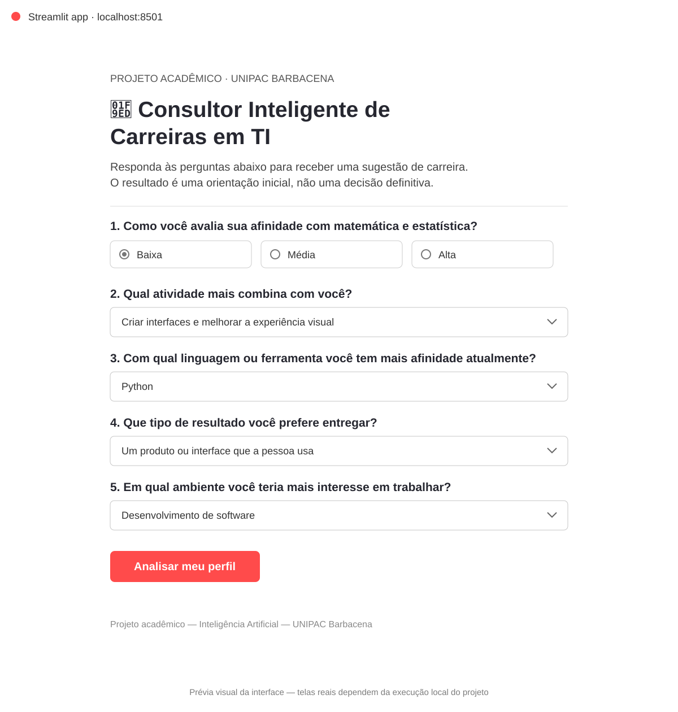
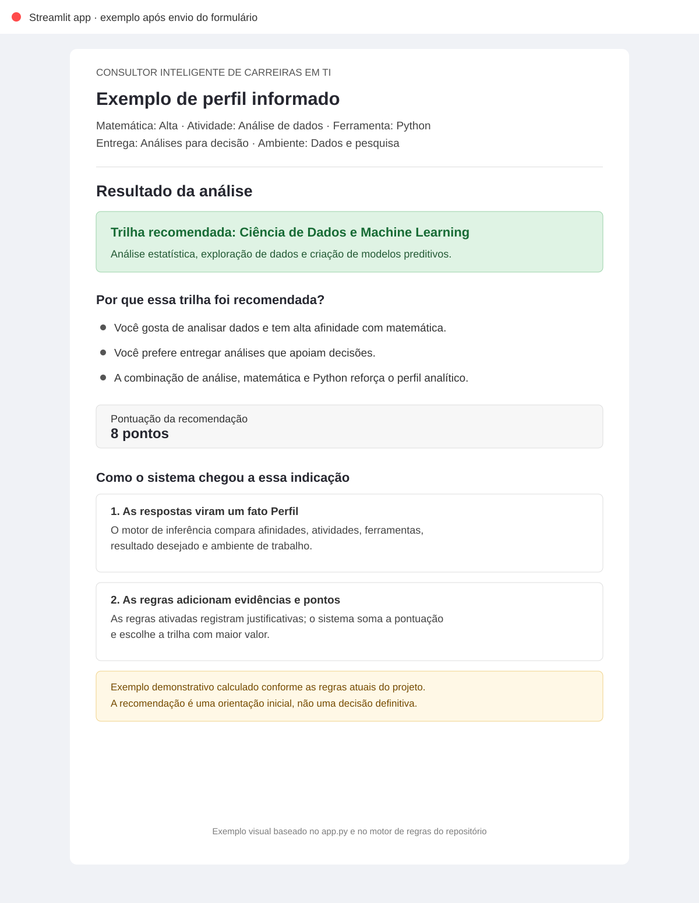
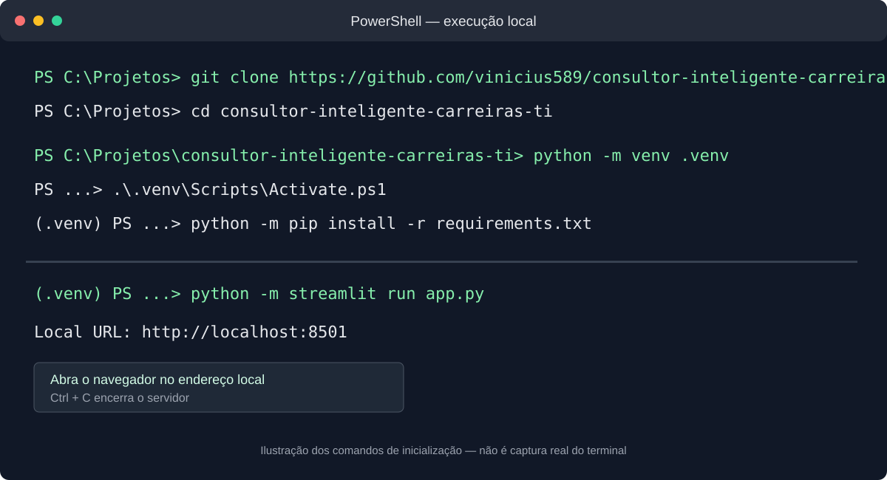

# 🧭 Consultor Inteligente de Carreiras em TI

Sistema especialista acadêmico desenvolvido em **Python** para a disciplina de Inteligência Artificial da **UNIPAC Barbacena**. A aplicação faz perguntas sobre interesses e preferências do usuário e recomenda uma trilha profissional em Tecnologia da Informação, explicando os motivos da indicação.

**Tecnologias:** Python · Experta · Streamlit · unittest · Git/GitHub

## 👀 Demonstração visual

### Tela inicial

A interface coleta cinco respostas: afinidade com matemática, atividade de maior interesse, ferramenta ou linguagem, tipo de resultado desejado e ambiente de trabalho.



### Exemplo de resultado

Neste exemplo, o perfil selecionado tem alta afinidade com matemática, gosta de analisar dados, escolhe Python, prefere produzir análises para apoiar decisões e se interessa por dados e pesquisa. Com essa combinação, as regras atuais recomendam **Ciência de Dados e Machine Learning**, com **8 pontos** e justificativas relacionadas às respostas.



> **Nota sobre as imagens:** as imagens acima são prévias visuais feitas a partir dos textos e do fluxo existentes no código; não são capturas de uma sessão real do navegador. O repositório não tem uma demonstração hospedada. Para ver a aplicação executando e testar suas próprias respostas, siga as etapas abaixo.

## 💡 O que o sistema faz

- Apresenta cinco perguntas sobre o perfil e os interesses profissionais.
- Aplica regras lógicas implementadas com **Experta**.
- Soma os pontos das regras ativadas para cada carreira.
- Exibe uma trilha recomendada, sua descrição, as justificativas e a pontuação.
- Permite consultar outras trilhas consideradas.
- Inclui testes automatizados para verificar cenários de perfil.

O motor de inferência contém **38 regras** (incluindo combinações de características do perfil) e considera dez trilhas profissionais:

1. Desenvolvimento Back-end
2. Desenvolvimento Front-end e UI/UX
3. Ciência de Dados e Machine Learning
4. Engenharia de Dados
5. Cibersegurança
6. DevOps e SRE
7. Computação em Nuvem
8. Desenvolvimento Mobile
9. Engenharia de Qualidade e Testes (QA)
10. Gestão de Produtos

## ▶️ Como executar no Windows

### 1. Requisitos

- **Python 3.10** é a versão recomendada para favorecer a compatibilidade com a biblioteca Experta.
- **Git** instalado no computador.

Para verificar as instalações, abra o PowerShell e execute:

```powershell
python --version
git --version
```

### 2. Baixar o projeto

```powershell
git clone https://github.com/vinicius589/consultor-inteligente-carreiras-ti.git
cd consultor-inteligente-carreiras-ti
```

### 3. Criar e ativar o ambiente virtual

```powershell
python -m venv .venv
.\.venv\Scripts\Activate.ps1
```

Se o PowerShell bloquear a ativação, você pode permitir scripts somente nessa sessão com `Set-ExecutionPolicy -Scope Process -ExecutionPolicy Bypass` e tentar novamente. Outra opção é executar os comandos seguintes usando diretamente `.\.venv\Scripts\python.exe`.

### 4. Instalar as dependências

Com o ambiente virtual ativado:

```powershell
python -m pip install --upgrade pip
python -m pip install -r requirements.txt
```

### 5. Iniciar a aplicação

```powershell
python -m streamlit run app.py
```

O Streamlit informa no terminal o endereço local. Normalmente, é:

**http://localhost:8501**

Abra esse endereço no navegador. Responda às cinco perguntas e clique em **Analisar meu perfil** para ver a recomendação e as justificativas.



Para encerrar a aplicação, volte ao terminal e pressione `Ctrl + C`.

## 🧪 Executar os testes

Na pasta do projeto, com as dependências instaladas, execute:

```powershell
python -m unittest discover -s tests -v
```

Os testes estão em `tests/test_personas.py` e verificam perfis que representam as diferentes trilhas. Ao final, o `unittest` informa se as verificações passaram.

## 🧠 Como a recomendação é calculada

1. A interface reúne as respostas do usuário em um perfil.
2. O motor de inferência compara esse perfil com as regras `SE–ENTÃO`.
3. Cada regra ativada registra uma evidência com carreira, pontos e justificativa.
4. O sistema soma as evidências e seleciona a carreira com maior pontuação.
5. O resultado mostra a descrição, os motivos e algumas alternativas.

A indicação é uma **orientação inicial** baseada nas respostas, não uma avaliação definitiva nem uma garantia de adequação profissional.

## 📁 Estrutura principal

| Arquivo | Função |
|---|---|
| `app.py` | Interface web feita com Streamlit |
| `sistema_especialista.py` | Fatos, regras e motor de inferência Experta |
| `matriz_de_decisao.md` | Resumo dos critérios usados nas recomendações |
| `tests/test_personas.py` | Testes automatizados de perfis |
| `requirements.txt` | Dependências do projeto |
| `assets/` | Imagens demonstrativas usadas neste README |

## 🔗 Repositório

Código-fonte: https://github.com/vinicius589/consultor-inteligente-carreiras-ti

---

**Projeto acadêmico — Inteligência Artificial — UNIPAC Barbacena.**
