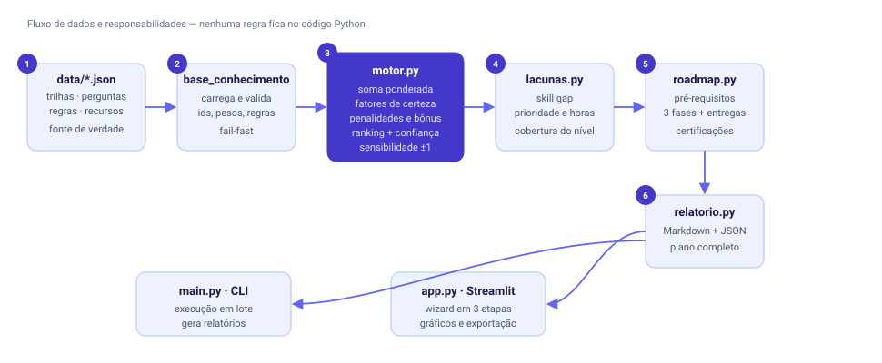

# 🧭 Consultor Inteligente de Carreiras em TI

**Sistema especialista com raciocínio ponderado, tratamento de incerteza e plano de carreira personalizado.**

Projeto acadêmico da disciplina de **Inteligência Artificial — UNIPAC Barbacena**.
A aplicação analisa o perfil do estudante em 17 perguntas de afinidade (escala 1–5), compara com **10 trilhas
de tecnologia**, calcula um ranking percentual, identifica **lacunas de competência** e monta um **roadmap**
com recursos gratuitos, certificações e projetos de portfólio.

`Python 3.10+` · `Streamlit` · `Plotly` · `pytest` · base de conhecimento 100% em JSON

---

## 🎯 O que o sistema faz

| Etapa | Resultado |
|---|---|
| **Perfil em 3 passos** | dados pessoais, 17 afinidades técnicas, objetivos e conhecimentos atuais |
| **Ranking ponderado** | Top 3 com percentual de aderência + ranking completo das 10 trilhas |
| **Tratamento de incerteza** | fatores de certeza (MYCIN), penalidades para perfis contraditórios, bônus para combinações coerentes |
| **Empate técnico** | quando as duas primeiras ficam a menos de 2,5 pontos, o sistema avisa, mostra a pergunta que mais as separa e sugere um teste prático |
| **Análise de lacunas** | compara seu conhecimento (0–3) com o exigido para estágio, júnior ou pleno |
| **Roadmap** | 3 fases, respeitando pré-requisitos, com links gratuitos, entregáveis e estimativa de horas/semanas |
| **Portfólio e certificação** | projetos escolhidos pelo quanto cobrem suas lacunas + certificações por custo e nível |
| **Exportação** | plano completo em Markdown e resultado estruturado em JSON |

---

## 🧠 Como o cálculo funciona

O motor tem quatro camadas, todas parametrizadas por `data/*.json`:

1. **Soma ponderada** — cada resposta `r` vira `a = (r − 1)/4` e é multiplicada pelo peso da pergunta em cada
   trilha (`w` pode ser negativo: matemática alta afasta Front-end, por exemplo).
2. **Normalização por faixa** — a pontuação bruta é comparada com o mínimo e o máximo alcançáveis *daquela*
   trilha, gerando uma força de 0 a 1.
3. **Fatores de certeza (MYCIN)** — as evidências de cada pergunta são combinadas (`cf1 + cf2(1 − cf1)` para
   positivas, `cf1 + cf2(1 + cf1)` para negativas, `(cf1 + cf2)/(1 − min)` para opostas), medindo a
   consistência do perfil.
4. **Regras de conflito e contexto** — 16 penalidades, 10 bônus e ajustes de objetivo/modalidade multiplicam a
   força; o percentual final aplica a calibração `100 × 0,97 × G^0,70`.

O detalhamento matemático completo está no [relatório técnico](docs/relatorio-tecnico.md).

---

## 📊 Resultados de validação

Saída real de `python tools/benchmark.py` (tabela completa em [docs/resultados-validacao.md](docs/resultados-validacao.md)):

| Perfil | 1º lugar | % | 2º lugar | % | Margem | Confiança |
|---|---|---|---|---|---|---|
| Analítico (matemática + dados) | Ciência de Dados e ML | 86,1% | Back-end | 79,6% | 6,5 | média |
| Visual (design + interface) | Front-end & UI/UX | 89,1% | Mobile | 81,7% | 7,4 | alta |
| Infraestrutura (Linux + automação) | DevOps & SRE | 91,5% | Arquitetura em Nuvem | 88,5% | 3,0 | média |
| Segurança (redes + defesa) | Cibersegurança | 84,6% | DevOps & SRE | 76,1% | 8,5 | alta |
| Negócios (produto + comunicação) | Gestão de Produtos | 91,8% | Front-end | 59,2% | 32,6 | alta |
| Back-end (lógica + código) | Back-end | 83,9% | QA | 70,9% | 13,0 | alta |

**Casos-limite também são testados:**

- **Perfil neutro** (todas as respostas 3): todos os percentuais entre 59% e 61%, empate declarado,
  confiança 0,02 e mensagem explícita de que o resultado é uma hipótese inicial.
- **Perfil contraditório** (design + infraestrutura + matemática no máximo): Dados 75,9% × Segurança 75,8%,
  margem de 0,1 ponto → empate detectado e teste de desempate sugerido.

---

## ▶️ Como executar (Windows)

```powershell
git clone https://github.com/vinicius589/consultor-inteligente-carreiras-ti.git
cd consultor-inteligente-carreiras-ti

python -m venv .venv
.\.venv\Scripts\Activate.ps1      # se bloquear: Set-ExecutionPolicy -Scope Process -ExecutionPolicy Bypass
python -m pip install --upgrade pip
python -m pip install -r requirements.txt

python -m streamlit run app.py    # abre em http://localhost:8501
```

### Linha de comando (sem interface)

```powershell
python main.py --perfil exemplos\perfil_devops.json --saida plano.md --json resultado.json
```

Saída no terminal:

```
   1. DevOps & SRE                            91.5%  ← recomendada
   2. Arquitetura em Nuvem                    88.5%
   3. Cibersegurança                          85.0%
```

### Testes

```powershell
python -m pytest                  # 55 testes, incluindo o wizard completo via AppTest
```

### Ferramentas de apoio

```powershell
python tools\benchmark.py --saida docs\resultados-validacao.md   # roda todos os perfis
python tools\exportar_matriz.py --saida docs\matriz-de-pesos.md  # matriz perguntas × trilhas
```

---

## 🗂️ Base de conhecimento (sem código)

Nenhum peso ou regra está no Python. Quatro arquivos compõem a base:

| Arquivo | Conteúdo |
|---|---|
| `data/trilhas.json` | 10 trilhas: dimensões, eixos do radar, competências por senioridade, tecnologias, certificações, projetos, sinais de mercado |
| `data/perguntas.json` | 3 etapas do formulário e as 17 perguntas com os pesos por trilha |
| `data/regras.json` | penalidades, bônus, ajustes por objetivo/modalidade, níveis e calibração |
| `data/recursos.json` | 57 competências com links gratuitos, horas-base, prática sugerida e pré-requisitos |

O carregamento é **fail-fast**: id duplicado, peso apontando para trilha inexistente, competência sem recurso
de estudo ou regra citando pergunta desconhecida interrompem a execução com mensagem clara — e há teste
para cada um desses casos.

Para incluir uma trilha nova: acrescente o objeto em `trilhas.json`, adicione pesos nas 17 perguntas de
`perguntas.json` e rode `python -m pytest`. A validação avisa exatamente o que falta.

---

## 🧱 Estrutura

```
.
├── app.py                      # interface Streamlit (wizard em 3 etapas)
├── main.py                     # entrada de linha de comando
├── data/                       # base de conhecimento (JSON)
│   ├── trilhas.json
│   ├── perguntas.json
│   ├── regras.json
│   └── recursos.json
├── src/consultor/
│   ├── base_conhecimento.py    # carregamento e validação
│   ├── motor.py                # soma ponderada + fatores de certeza + ranking
│   ├── lacunas.py              # skill gap por senioridade
│   ├── roadmap.py              # fases, certificações, portfólio
│   ├── relatorio.py            # exportação Markdown/JSON
│   └── cli.py                  # execução em lote
├── exemplos/                   # 8 perfis (6 personas + 2 casos-limite)
├── tests/                      # 55 testes (unidade, integração, interface)
├── tools/                      # benchmark e exportação da matriz
├── docs/                       # relatório técnico, matriz, validação, arquitetura
└── legacy/                     # versão anterior (Experta, regras binárias)
```



---

## 📚 Documentação

- [Relatório técnico](docs/relatorio-tecnico.md) — modelagem, fórmulas, decisões de projeto, limitações
- [Matriz de pesos](docs/matriz-de-pesos.md) — 17 perguntas × 10 trilhas, com cobertura por trilha
- [Resultados de validação](docs/resultados-validacao.md) — tabela gerada por `tools/benchmark.py`
- [Arquitetura](docs/arquitetura.svg) — fluxo entre os módulos

---

## 🔁 Evolução em relação à versão anterior

A primeira entrega da disciplina usava **regras SE–ENTÃO binárias no Experta**, com 5 perguntas de múltipla
escolha e uma única recomendação. Esta versão substitui o motor por inferência ponderada com fatores de
certeza, base externa em JSON e plano de ação — mas a versão original continua no repositório, em
[`legacy/`](legacy), com seus testes (executados apenas se o Experta estiver instalado):

```powershell
python -m pip install -r legacy\requirements-experta.txt
python -m pytest legacy -q
```

---

## ⚠️ Limitações

- Os pesos foram calibrados por julgamento de especialista e validados com personas sintéticas; não houve
  validação estatística com amostra real de estudantes.
- As faixas salariais são estimativas de mercado, não dados oficiais.
- O sistema depende da autoavaliação honesta de competências.
- A recomendação é uma **hipótese de trabalho**, não diagnóstico vocacional nem garantia de empregabilidade.

---

**Projeto acadêmico — Inteligência Artificial — UNIPAC Barbacena.**
