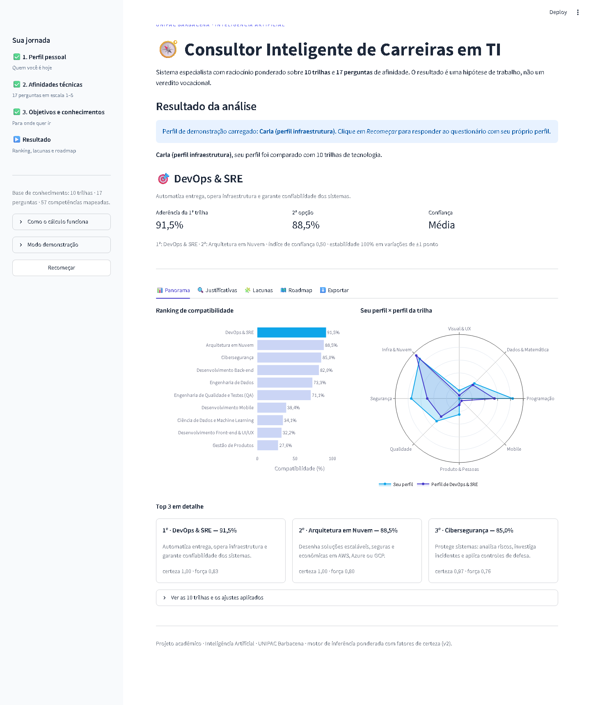

# 🧭 Consultor Inteligente de Carreiras em TI

Sistema especialista em **Python** que indica a trilha de tecnologia mais compatível com o perfil do
estudante, mostra as **lacunas de competência** e monta um **plano de estudos** com certificações e
projetos de portfólio.

Trabalho da disciplina de **Inteligência Artificial — UNIPAC Barbacena**.

## O que o sistema faz

- Questionário em 3 etapas: perfil pessoal, **17 afinidades técnicas em escala 1–5** e objetivos.
- Compara o perfil com **10 trilhas** (Back-end, Front-end/UX, Dados/ML, Engenharia de Dados,
  Cibersegurança, DevOps/SRE, Cloud, Mobile, QA e Produto).
- Calcula **pontuação ponderada com fatores de certeza** e mostra o ranking com percentual de
  aderência (Top 3 + as 10 trilhas).
- Aplica **penalidades** para perfis contraditórios e detecta **empate técnico**.
- Compara o conhecimento atual com o nível escolhido (estágio, júnior ou pleno) e lista as
  **lacunas**, com prioridade e horas estimadas.
- Gera o **roadmap** em 3 fases, com links gratuitos, certificações e projetos para o GitHub.

## Como executar

```powershell
git clone https://github.com/vinicius589/consultor-inteligente-carreiras-ti.git
cd consultor-inteligente-carreiras-ti

python -m venv .venv
.\.venv\Scripts\Activate.ps1
python -m pip install -r requirements.txt

python -m streamlit run app.py
```

Abre em `http://localhost:8501`.

Para ver um resultado sem responder ao questionário, use o menu **Modo demonstração** na barra
lateral ou acrescente `?perfil=perfil_devops` à URL.

## Como testar

```powershell
python -m pytest
```

São **55 testes** (motor, lacunas, roadmap, base de conhecimento, casos-limite, relatório e o
wizard completo pela interface).

## Prints dos testes

Todos os testes manuais estão documentados, com print, em **[TESTES.md](TESTES.md)**:
fluxo do wizard, abas do resultado, 6 personas, 2 casos-limite, cobertura das 10 trilhas e a
saída do pytest.



## Estrutura

```
app.py                      interface Streamlit (wizard + resultado)
data/                       base de conhecimento em JSON
src/consultor/
  base_conhecimento.py      leitura e validação dos JSON
  motor.py                  pontuação ponderada, certeza, penalidades e ranking
  lacunas.py                análise de lacunas por senioridade
  roadmap.py                fases, certificações e portfólio
  relatorio.py              exportação em Markdown e JSON
  servico.py                execução completa de um perfil
tests/                      55 testes automatizados
exemplos/                   perfis usados nos testes manuais
docs/prints/                prints dos testes
TESTES.md                   relatório dos testes manuais
```

## Base de conhecimento

Nenhum peso ou regra fica no código Python:

| Arquivo | Conteúdo |
|---|---|
| `data/trilhas.json` | 10 trilhas, competências por nível, certificações, projetos e mercado |
| `data/perguntas.json` | 3 etapas do formulário e as 17 perguntas com os pesos por trilha |
| `data/regras.json` | penalidades, bônus, ajustes por objetivo e calibração |
| `data/recursos.json` | 57 competências com links, horas e pré-requisitos |

Para alterar o comportamento do sistema, edite os JSON — o código apenas interpreta e valida.

## Observação

A recomendação é uma orientação construída a partir das respostas do usuário, não um diagnóstico
vocacional nem garantia de empregabilidade.
