# Testes manuais — evidências

Registro dos testes executados manualmente na aplicação, com o print de cada resultado.
Os perfis de entrada estão em [`exemplos/`](exemplos) e podem ser recarregados pelo modo
demonstração (`?perfil=perfil_devops` na URL ou menu **Modo demonstração** na barra lateral).

## Como reproduzir

```powershell
python -m streamlit run app.py
```

Depois abra `http://localhost:8501/?perfil=perfil_devops` (troque o final pelo perfil desejado)
ou use o menu **Modo demonstração** → **Carregar perfil de exemplo**.

---

## 1. Fluxo da interface (wizard)

| # | Caso | Resultado esperado | Obtido | Print |
|---|---|---|---|---|
| 1 | Abrir a aplicação | Passo 1 com nome, formação, experiência e horas semanais | OK | [01](docs/prints/01-passo-1-perfil.png) |
| 2 | Avançar para o Passo 2 | 17 perguntas em escala 1–5, contador de respondidas | OK | [02](docs/prints/02-passo-2-afinidades.png) |
| 3 | Avançar para o Passo 3 | Objetivo, nível, prazo, modalidade + autoavaliação filtrada pelas trilhas afins | OK | [03](docs/prints/03-passo-3-objetivos.png) |

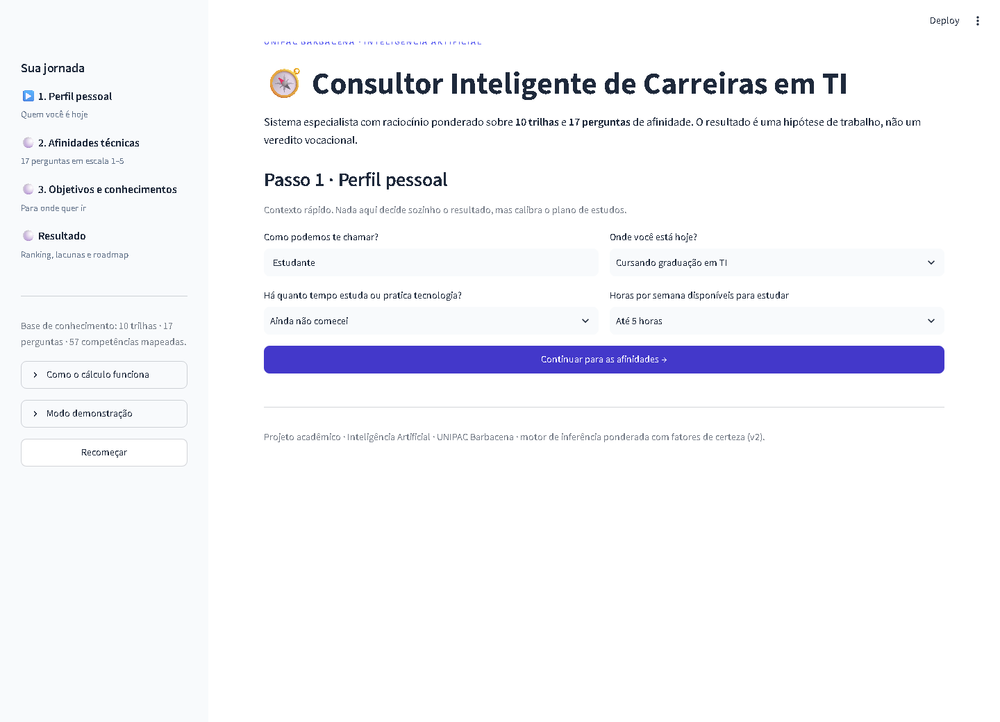

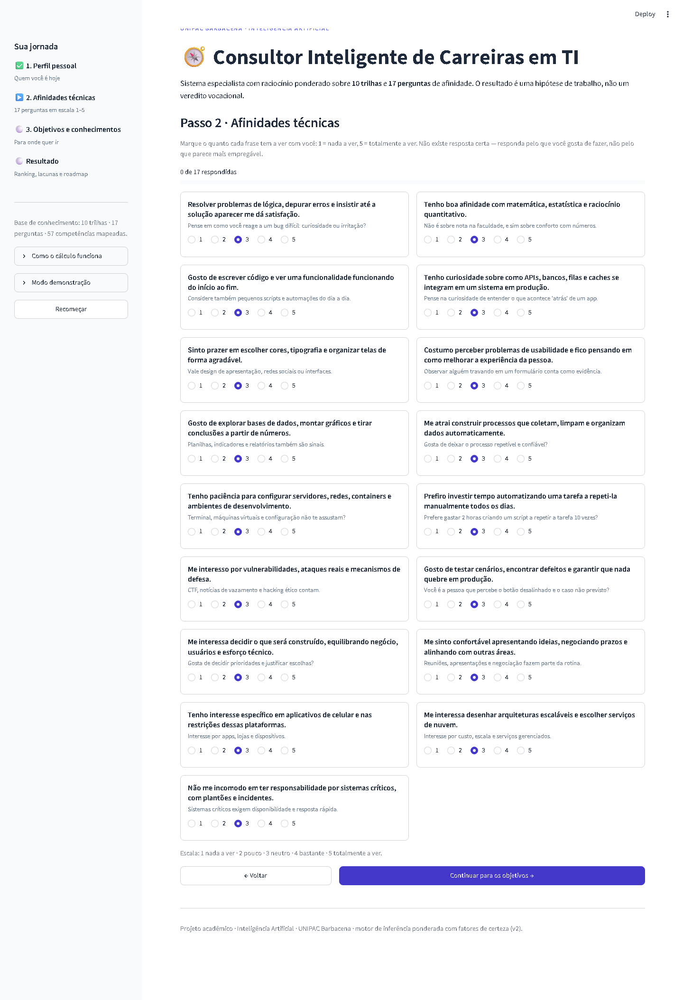

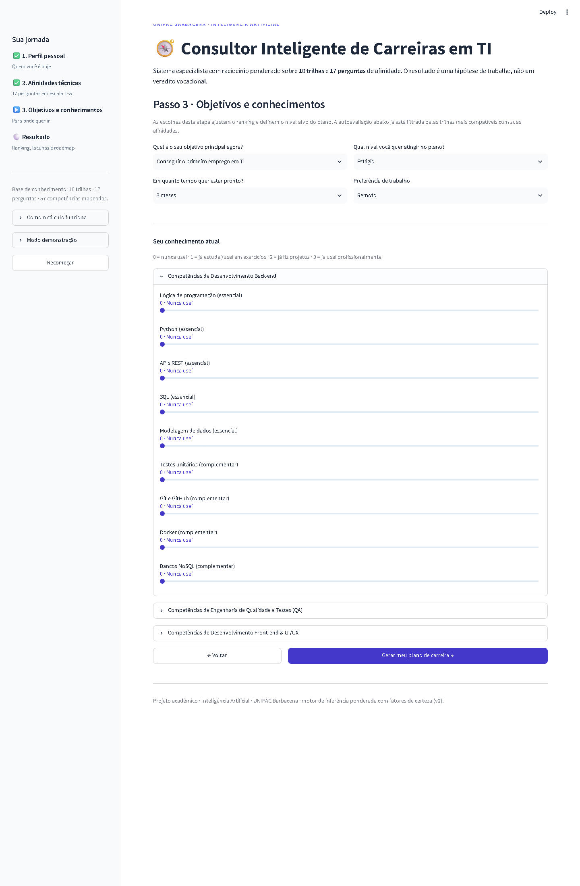

---

## 2. Tela de resultado

Perfil usado: `perfil_devops.json`.

| # | Aba | Resultado esperado | Obtido | Print |
|---|---|---|---|---|
| 4 | Panorama | Ranking em barras, radar do perfil, Top 3 com percentuais | OK | [04](docs/prints/04-resultado-panorama.png) |
| 5 | Justificativas | Evidências que sustentam a 1ª colocada e o que afastou as demais | OK | [05](docs/prints/05-resultado-justificativas.png) |
| 6 | Lacunas | Cobertura, prioridade, nível atual → necessário e horas por competência | OK | [06](docs/prints/06-resultado-lacunas.png) |
| 7 | Roadmap | 3 fases com semanas, entregáveis, certificações e projetos | OK | [07](docs/prints/07-resultado-roadmap.png) |
| 8 | Exportar | Download do plano em Markdown e do resultado em JSON | OK | [08](docs/prints/08-resultado-exportar.png) |

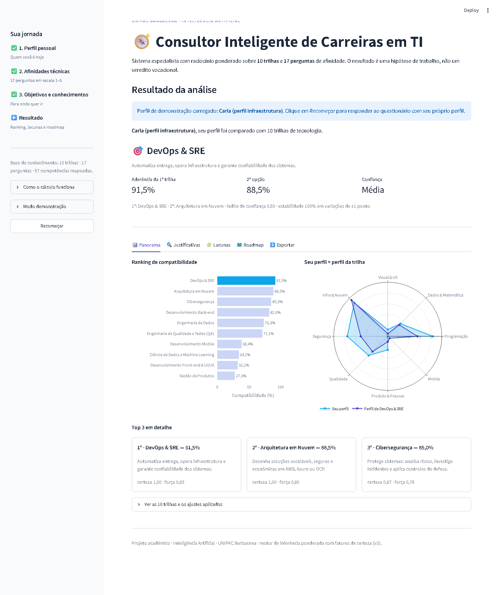

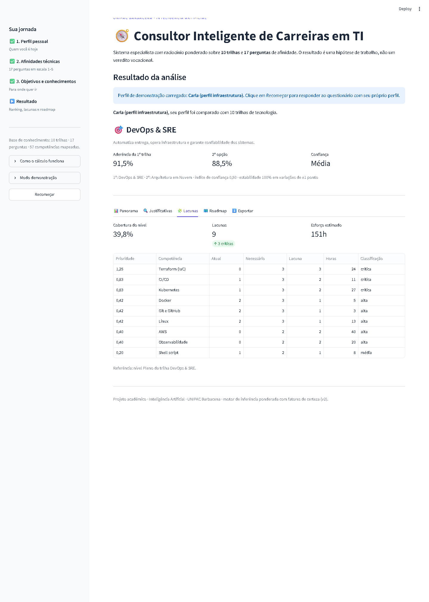

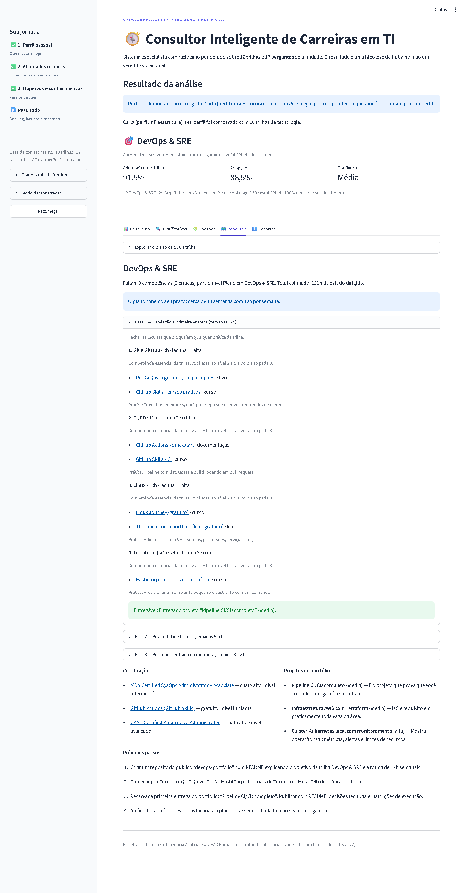

---

## 3. Perfis de validação (personas)

Cada perfil foi carregado pelo modo demonstração e o resultado conferido com o esperado.

| # | Perfil | Entrada resumida | Esperado | Obtido | Print |
|---|---|---|---|---|---|
| 9 | Analítico | matemática 5, dados 5, código 4 | Ciência de Dados e ML | **Ciência de Dados e ML — 86,1%** | [print](docs/prints/persona-analitico.png) |
| 10 | Visual | visual 5, usabilidade 5, matemática 1 | Front-end & UI/UX | **Front-end & UI/UX — 89,1%** | [print](docs/prints/persona-frontend.png) |
| 11 | Back-end | lógica 5, código 5, infra 3 | Desenvolvimento Back-end | **Desenvolvimento Back-end — 83,9%** | [print](docs/prints/persona-backend.png) |
| 12 | Infraestrutura | infra 5, automação 5, plantão 4 | DevOps & SRE | **DevOps & SRE — 91,5%** | [print](docs/prints/persona-devops.png) |
| 13 | Segurança | segurança 5, infra 5, redes 2 | Cibersegurança | **Cibersegurança — 84,6%** | [print](docs/prints/persona-seguranca.png) |
| 14 | Negócios | produto 5, comunicação 5, código 1 | Gestão de Produtos | **Gestão de Produtos — 91,8%** | [print](docs/prints/persona-produto.png) |

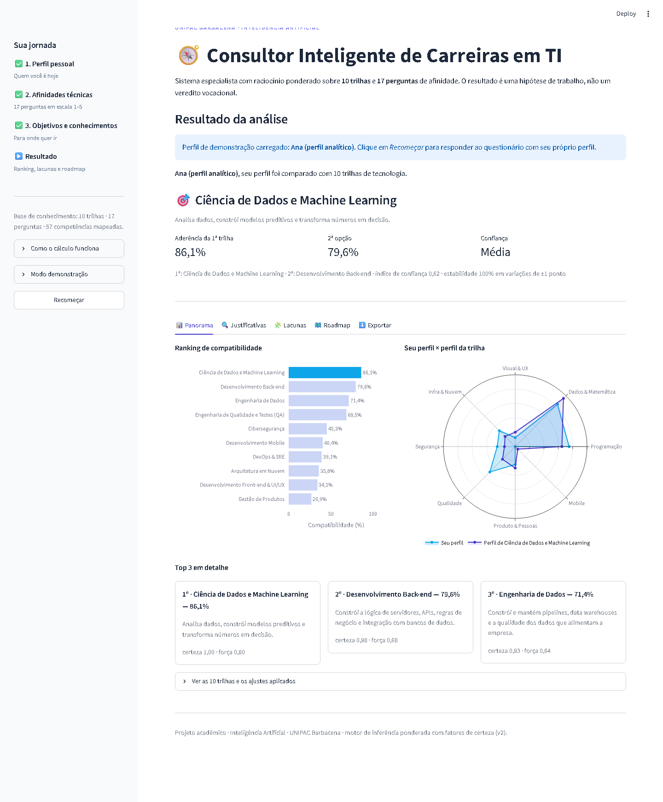

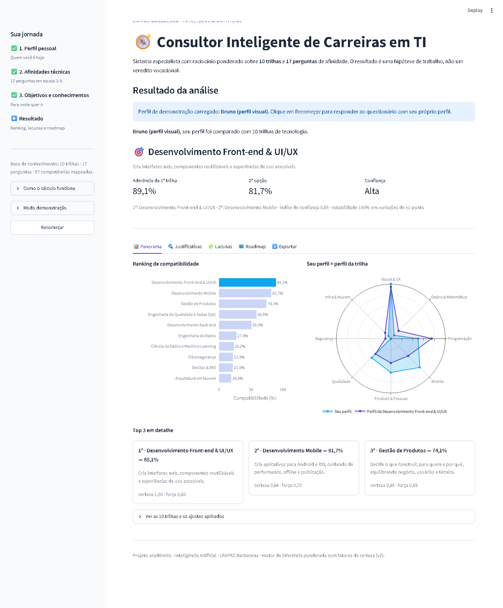


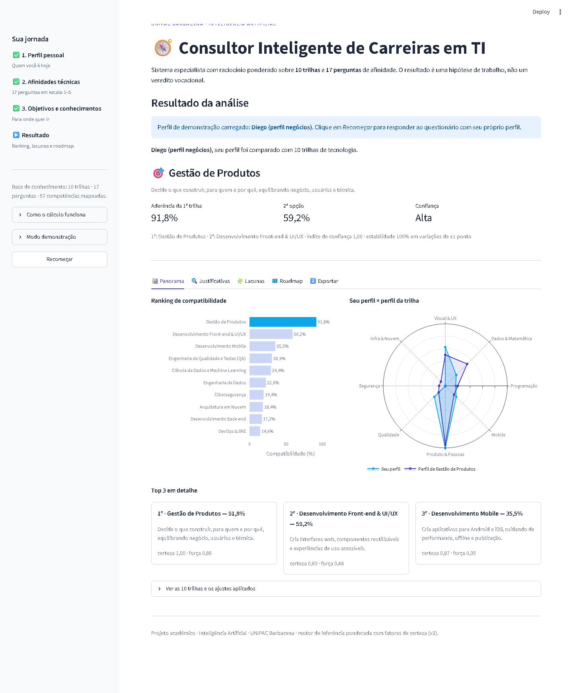

---

## 4. Casos-limite

| # | Caso | Entrada | Esperado | Obtido | Print |
|---|---|---|---|---|---|
| 15 | Perfil neutro | todas as respostas = 3 | Ranking sem evidência forte, empate declarado e confiança baixa | **Empate: QA 61,4% × Back-end 60,7%, confiança baixa (0,02)** | [print](docs/prints/caso-limite-neutro.png) |
| 16 | Perfil contraditório | design 5 + infraestrutura 5 + matemática 5 | Empate técnico com sugestão de desempate | **Empate: Dados 75,9% × Segurança 75,8%, desempate sugerido** | [print](docs/prints/caso-limite-conflitante.png) |

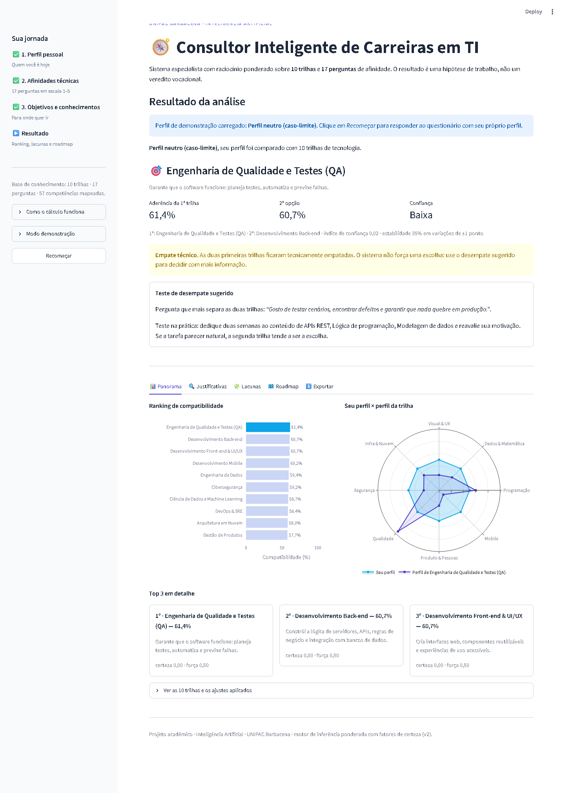

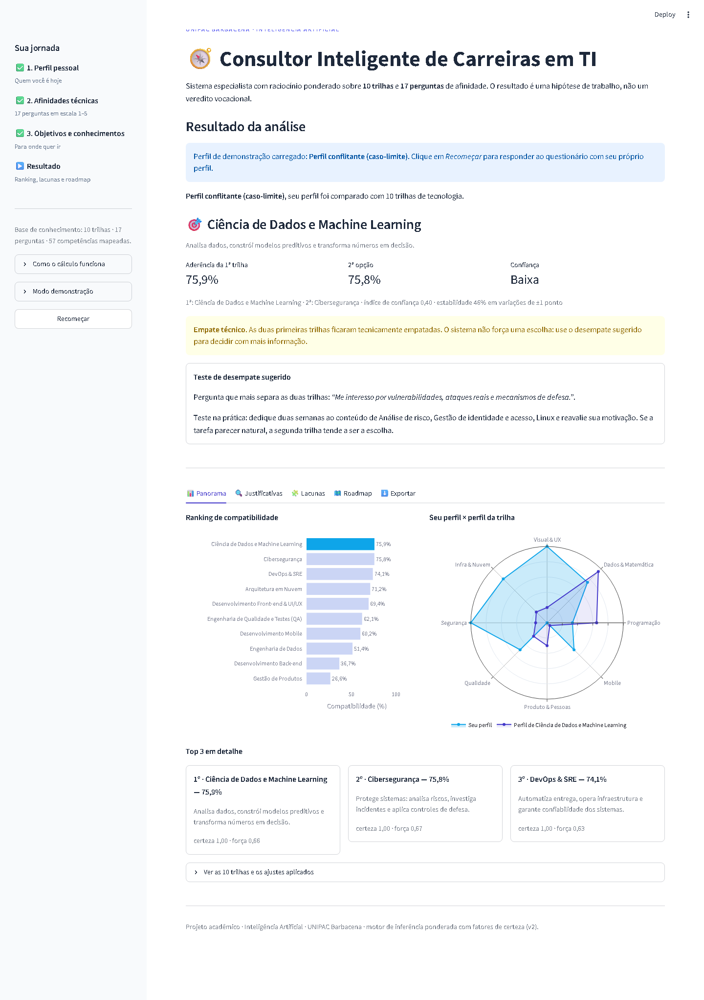

---

## 5. Cobertura das 10 trilhas

As seis personas acima já levam ao 1º lugar seis trilhas (Dados, Front-end, Back-end, DevOps,
Segurança e Produto). Para as três restantes foi usado o perfil ideal da própria trilha
(gerado a partir dos pesos da base), confirmando que nenhuma trilha é inalcançável.

| # | Trilha | Entrada | Obtido | Print |
|---|---|---|---|---|
| 17 | Desenvolvimento Mobile | perfil ideal da trilha | **Mobile — 97,0%** | [print](docs/prints/perfil-ideal-mobile.png) |
| 18 | Arquitetura em Nuvem | perfil ideal da trilha | **Arquitetura em Nuvem — 97,0%** | [print](docs/prints/perfil-ideal-cloud.png) |
| 19 | Engenharia de Dados | perfil ideal da trilha | **Engenharia de Dados — 97,0%** | [print](docs/prints/perfil-ideal-eng-dados.png) |
| — | QA | perfil neutro (empate) | QA em 1º por critério de desempate | ver item 15 |

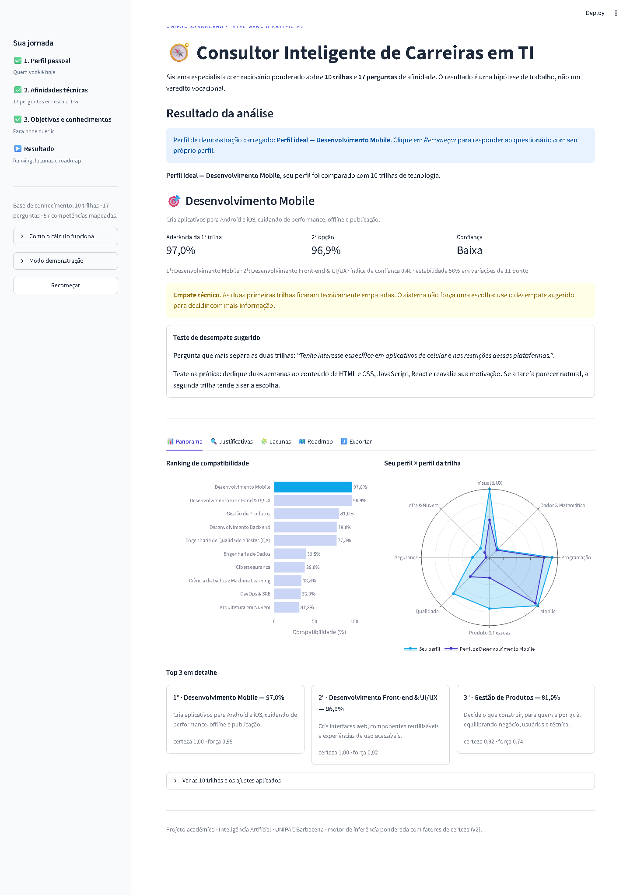


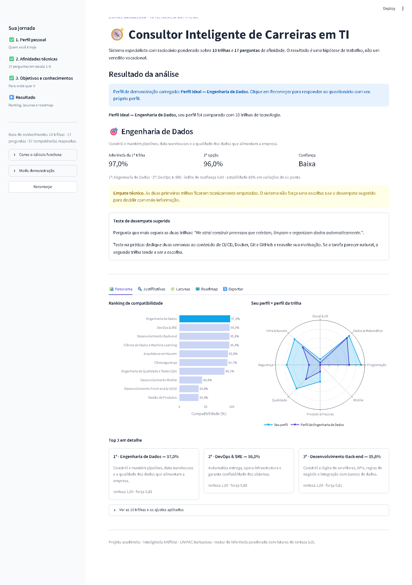

---

## 6. Testes automatizados

```powershell
python -m pytest
```

Resultado: **55 testes aprovados** (motor, lacunas, roadmap, base de conhecimento, casos-limite,
relatório e wizard completo pela interface).

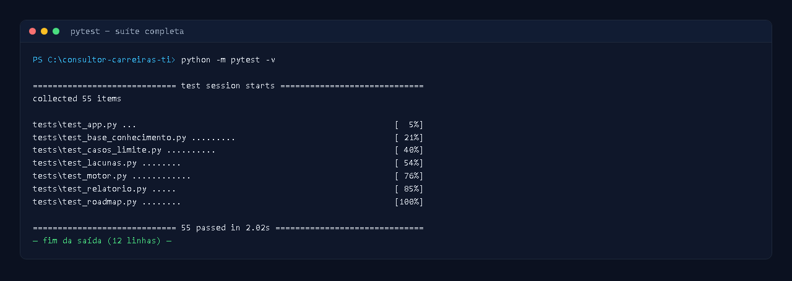
